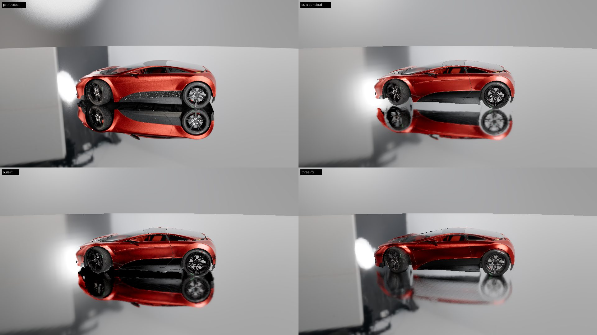
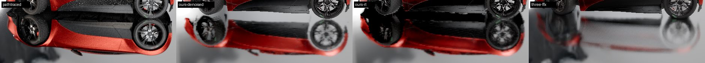
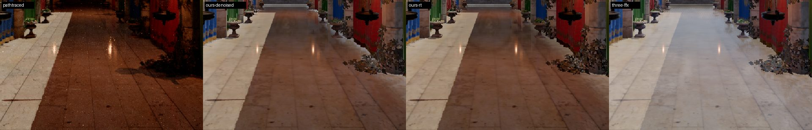
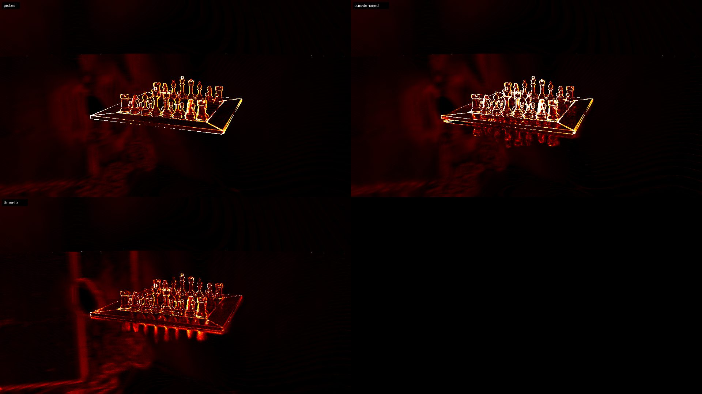

# Showcase vs a path tracer, and ours vs three's SSRNode + FFX (W21)

**Short answers.**
1. **"With RT on the scenes look very different": the path tracer sides with RT.** It agrees with ours + RT on what the floor reflects of the model: the car's underside and far side, and the chess pieces under the board. SSR alone can't see those, so it fills them with the probe, which on the studio stages is the bright environment. What still differs from the path tracer in both of our modes is the environment seen in the near-mirror floor. Ours shows it blurred, because the misses (SSR and RT alike) take a 128 px probe. three's SSR samples the HDRI directly, so it is sharp there, and that is where three beats us on the studio stages. In Sponza it's the reverse: three's shaded floor reflects the sky (MAD 64.7 against our 26.9).
2. **"Ours boils, the denoiser repo's demo doesn't": in this tool, ours does not boil more than three's SSRNode + FFX.**
   - **At rest,** our denoised temporal std is 3–5x lower on every scene: 0.03–0.14 against 0.15–0.65 (8-bit luma).
   - **In a slow orbit,** the flicker is equal on the cars and in Sponza. On chess it is higher (0.25 against 0.16), with a confound explained below.
   - **Raw,** ours is quieter than three's raw too (std 0.45–9.3 against 1.9–20.6).
   - **Inputs:** I found no wrong input convention to the denoiser, so nothing was fixed.
   - **Why the demo looks calm:** different content and post-processing (forced roughness 0.3, no normal maps, `mirrorBias` 0.5, TRAA + sharpen + grade). These would hide noise for either pipeline.
   - **Real structural gap:** our one ray per 2x2 quad runs without FFX's variance-guided extra rays.

The tool is `examples/showcase/compare.html`. The data is in `docs/research/showcase-compare.json`, the screenshots in `docs/research/showcase-compare/`. The machine was Apple Silicon with Chrome headless (WebGPU on Metal, WebGL on ANGLE/Metal), at 960x540.

> **Update (W23).** The reference is now three-gpu-pathtracer's **WebGPU** tracer (0.0.28) plus an **OIDN denoise** (the Denoiser repo's `denoiser` package), and it **stops**: at rest it traces to *Max samples* (default 8), denoises once, shows that, and goes idle. Moving the camera restarts it. **Clearcoat renders correctly in this tracer and is back in the reference.** The A / B sides are picked in a bar above the image, with one-click pairs. The numbers below were measured by W21 against the old WebGL reference (clearcoat dropped, 592-2109 spp, not denoised) and have not been re-run. A quick check on carConcept at 32 denoised spp gives the same MADs for ours (20.8 against 21.0) and ours + RT (17.5 against 17.5).

## The tool

`http://127.0.0.1:<port>/showcase/compare.html?scene=carConcept&left=ours-rt&right=pathtraced`. There is also a link in the showcase panel.

- **Methods** (either side): ours raw / denoised / hybrid with RT, probes only, three r187 `SSRNode` raw (stochastic) / with its own denoiser (`TemporalReprojectNode` + `RecurrentDenoiseNode`, example parameters) / with FFX (`ffxReflections()` from denoiser/three, wired as `Denoiser/examples/three-temporal/src/ssr.ts` side B), and path traced.
- **Isolation.** Each method has its own canvas, its own renderer and WebGPU device (the path tracer and its OIDN denoiser share one) and its own fresh load of the scene and HDRI. Nothing is shared between renderers.
- **Split view.** The two canvases are stacked, and the right one is clipped with `clip-path: inset(0 0 0 x%)` at a draggable divider. **A** is left of the divider and **B** right of it. Each has a picker in the bar above the image (A over the left half, B over the right), with a swap button and quick pairs: ours + RT vs path traced, ours vs path traced, ours vs three SSR + FFX, ours vs ours + RT. The labels on the image repeat the A / B badge, the method and its status. One `OrbitControls` camera is copied into every method each frame. "Freeze camera" stops the orbit.
- **Display.** Every method is AgX + sRGB at the scene's exposure (one slider for all). There is no TRAA, sharpen or grade anywhere (D2302).
- **Path tracer (W23).** three-gpu-pathtracer's `WebGPUPathTracer` 0.0.28 (a devDependency; `$PATHTRACER_REPO` overrides) in its own canvas and device, with MIS, 8 bounces and `filterGlossyFactor` 0.
  - **When it traces:** while the camera moves it restarts each frame, so you see raw samples. At rest it accumulates to **Max samples** (panel, default 8, 1-512, `?ptMax=`).
  - **At the cap:** it stops dispatching, rasterizes albedo + view normal, and runs OIDN once (the Denoiser repo's `denoiser` package on the same device, zero copy, linear out, AgX on present like every other method). The layer then stays idle.
  - **Show denoised** switches raw / denoised (`?ptRaw=1`).
  - **Timing:** still to denoised takes 0.35 s on toyCar, 0.44 s on carConcept and 4.4 s on Sponza (headless, 960x540, 8 spp). A blank denoise at load warms the network, so the cap doesn't wait for it.
  - **Clearcoat** is kept (D2303). The denoise biases the reference (D2305).
- **Readout ("Measure").** With the camera frozen, it path-traces the reference to N spp (then OIDN, since W23) and takes the glossy mask from our G-buffer (perceptual roughness < 0.447). Each method then runs from reset: 48 warm-up frames, then 32 measured. The columns:
  - **MAD**: mean |frame − reference|, noise included.
  - **bias**: |temporal mean − reference|.
  - **std**: per-pixel temporal std of luma, mean and p99.
  - **orbit**: the mean |second temporal difference| of luma over a 0.05°/frame orbit. It needs no reference. Smooth motion cancels and frame-to-frame noise doesn't.
  - **Units:** 8-bit display (0–255): what the eye gets (D2304).
- **Headless hooks.** `window.__p.measure()`, `flickerMap(id)`, `shot()`, `shotOf(id)`, `converge(spp)` (traces to the cap, denoises, returns the tracer's info), `ptInfo()`, `showDenoised(v)` and `setSides(a, b)`.
- **URL overrides** for experiments (never defaults): `?spq=`, `?tsf=`, `?hit=`, `?motionScale=`, `?mirrorBias=`, `?ssrMaxDistance=`, `?ssrThickness=`, `?floorRoughness=`, `?ptBounces=`, `?ptMax=`, `?ptRaw=1`, `?ptDenoise=0`, `?ptClearcoat=0`.
- **Smoke:** `pnpm check -- --only showcase-compare`.

Two bugs in the tool were found and fixed while building it, so they are not in the numbers below:

- **Black probes in every method but the first.** three's `CubeMapNode` caches its equirect-to-cube conversion per texture, not per renderer (r187, `nodes/utils/CubeMapNode.js` `_cache`). With the showcase's shared HDR cache, every renderer after the first baked its probes from a cube that only exists on the first device, so every mirror read black. That looked exactly like "RT makes it very different". Each method now loads its own HDRI. Single-renderer pages (the showcase itself) are not affected.
- **Black clearcoat in the path tracer.** three-gpu-pathtracer renders clearcoat black on ToyCar and CarConcept paint, in the local checkout and in the upstream build the upscaler pins alike, at any roughness and with the maps stripped. The reference drops the clearcoat layer (D2303).

## 1. What the path tracer says about the "very different" look

*carConcept, hero pose. Top left: path traced (592 spp). Top right: ours denoised. Bottom left: ours + RT. Bottom right: three SSR + FFX.*

*The floor under the car, in the same order.*

- **The model's reflection: RT is right.**
  - The path tracer shows the whole mirrored car: dark underside, sills and both wheels.
  - Ours + RT shows the same.
  - Ours (SSR only) leaves a **white gap** between the car and its reflection, and the rear of the reflection breaks up. Those rays leave the screen or pass under the car, where the camera sees nothing, so the composite fills them with the probe, which there is the bright studio.
  - three's SSR fades the reflection out instead: its misses take the HDRI.
  - On the glossy pixels, MAD goes 21.0 → **17.5** with RT on carConcept, 26.9 → **24.2** in Sponza, and is unchanged on toyCar (16.7 → 16.4) and chess (14.1 → 14.0).
  - The gap is also what W22 is fixing (the blend is by confidence only). Here RT replaces the gap's content, so it changes most where SSR can't see.
- **The environment in the floor: neither of our modes is right.** The path tracer shows the studio's softbox and stand sharp in the mirror floor (roughness 0.03), and so does three's SSR, which samples the HDRI. Ours shows a soft bright blob.
  - Our misses (screen-space and traced alike) take the probe, a 128 px capture projected onto a far box. It can't hold a mirror-sharp HDRI.
  - **Probes only** has the largest bias of all (19.3 / 25.3 / 15.5 on toyCar / carConcept / chess).
  - This is most of our error on the studio stages, and it is why three + FFX has the lower MAD there (5.2 / 15.7 / 3.7 against our 16.7 / 21.0 / 14.1).
  - It also blurs any HDRI light into a halo on the floor.
- **Sponza: the path tracer is closer to ours than to three.**
  - In the shaded aisle the path tracer's polished floor reflects the dark arches and the torches. Ours (probes per region) is dark and warm. three's is pale, because its misses go to the sky HDRI (MAD 64.7 against our 26.9, ours + RT 24.2).
  - **Caveat:** Sponza's reference differs everywhere, not just in reflections. The raster pipelines have unoccluded image-based diffuse (no AO), so the aisles are much brighter than the path tracer's (D2303). Use Sponza for where reflections go, not for absolute numbers.

*Sponza, the polished floor: path traced, ours denoised, ours + RT, three SSR + FFX.*

More shots: [toyCar](showcase-compare/grid-toyCar.jpg), [chess](showcase-compare/grid-chess.jpg), [Sponza](showcase-compare/grid-sponza.jpg). The toyCar's body differs in the path tracer because its glass and clearcoat are handled differently. That is the materials, not the reflections.

**What would close the remaining gap.** On near-mirror floors, the environment past the probe should come at the floor's own roughness, from the HDRI directly (where coverage is outside every probe), or from a higher-resolution probe. This is the existing backlog item "misses' fallback at the pixel's roughness" (W15 D1806 / W18 (4)), now with a picture. Not done here.

## 2. Boiling: ours vs three's SSRNode + FFX

### Readout, default scenes (still camera, 8-bit display units over the glossy mask)

| scene | method | MAD | bias | std mean / p99 | orbit 0.05°/f |
|---|---|---|---|---|---|
| toyCar (335k px) | ours raw | 16.43 | 16.37 | 0.45 / 18.7 | 0.60 |
| | **ours denoised** | 16.69 | 16.69 | **0.04 / 1.1** | **0.17** |
| | ours + RT | 16.39 | 16.39 | 0.05 / 0.9 | 0.18 |
| | probes only | 19.36 | 19.36 | 0 / 0 | 0.14 (floor) |
| | three raw | 5.20 | 4.63 | 2.68 / 68.7 | 2.28 |
| | three + its denoiser | 5.30 | 5.29 | 0.11 / 1.6 | 0.15 |
| | **three + FFX** | 5.23 | 5.22 | **0.20 / 3.6** | **0.20** |
| carConcept (368k) | ours raw | 21.38 | 20.98 | 2.54 / 41.4 | 2.80 |
| | **ours denoised** | 21.03 | 21.02 | **0.13 / 2.4** | **0.33** |
| | ours + RT | 17.47 | 17.47 | 0.14 / 2.1 | 0.32 |
| | probes only | 25.21 | 25.21 | 0 / 0 | 0.24 (floor) |
| | three raw | 17.49 | 14.62 | 8.04 / 86.6 | 6.77 |
| | three + its denoiser | 15.76 | 15.76 | 0.25 / 2.5 | 0.26 |
| | **three + FFX** | 15.68 | 15.67 | **0.48 / 5.5** | **0.33** |
| chess (373k) | ours raw | 14.32 | 14.01 | 0.98 / 29.8 | 1.22 |
| | **ours denoised** | 14.07 | 14.07 | **0.03 / 0.7** | **0.25** |
| | ours + RT | 13.97 | 13.97 | 0.07 / 0.9 | 0.29 |
| | probes only | 15.53 | 15.53 | 0 / 0 | 0.17 (floor) |
| | three raw | 4.42 | 3.83 | 1.92 / 36.9 | 1.71 |
| | three + its denoiser | 3.77 | 3.77 | 0.10 / 1.3 | 0.15 |
| | **three + FFX** | 3.66 | 3.66 | **0.15 / 2.0** | **0.16** |
| Sponza (120k) | ours raw | 26.75 | 26.64 | 1.98 / 19.7 | 3.23 |
| | **ours denoised** | 26.90 | 26.90 | **0.11 / 0.8** | **2.28** |
| | ours + RT | 24.17 | 24.16 | 0.15 / 1.2 | 2.45 |
| | probes only | 30.28 | 30.28 | 0 / 0 | 2.25 (floor) |
| | three raw | 64.01 | 63.94 | 5.40 / 30.2 | 6.10 |
| | three + its denoiser | 64.77 | 64.77 | 0.29 / 1.5 | 2.24 |
| | **three + FFX** | 64.67 | 64.67 | **0.41 / 2.4** | **2.22** |

The references are 592–2109 spp. MAD and bias are against the path tracer, std and orbit need no reference. Sponza's orbit floor (2.25) is high because of its texture detail and moving edges.

**Glossy floor** (carConcept, `?floorRoughness=0.25`, where one ray per quad is noisiest):

| method | std mean / p99 | orbit 0.05°/f | orbit 0.5°/f |
|---|---|---|---|
| probes only (floor) | 0 / 0 | 0.22 | 1.04 |
| ours raw | 9.25 / 69.1 | 10.27 | |
| **ours denoised** | **0.14 / 1.5** | **0.33** | **1.36** |
| ours denoised, `?spq=4` | 0.10 / 1.0 | | 1.29 |
| three raw | 20.57 / 78.1 | 17.91 | |
| **three + FFX** | **0.65 / 3.3** | **0.34** | **1.36** |
| three + its denoiser | 0.49 / 3.0 | | 1.28 |

### What that says

- **At rest, ours boils less than three + FFX on every scene, glossy floor included.** Its p99 std stays under 2.5/255. A std under about 1/255 cannot show at all in an 8-bit image.
- **In motion it's a tie, except chess.** On toyCar, carConcept, Sponza and the glossy floor (slow or fast orbit), ours denoised is within ±0.03 of three + FFX. On chess it is 0.25 against 0.16. The confound:
  - The orbit column has no reference, so moving content sets a floor per method. Our noise-free floor (probes only) is 0.17 on chess, while three's lit image has no environment specular at all (its example patch), so its floor is lower and unknown.
  - The heat map shows where ours adds flicker: the pieces and the top of the board. Below, black is 0 and white is ≥ 4/255 per frame.

*Orbit flicker per pixel on chess: probes only (our floor), ours denoised, three SSR + FFX.*

- **What doesn't move the chess number.** None of these changed it (ours denoised, orbit 0.255 at defaults):

  | change | orbit |
  |---|---|
  | denoiser motion scaled ×0 / ×0.5 / ×2 (`?motionScale`) | 0.262 / 0.257 / 0.253 |
  | four rays per quad (`?spq=4`) | 0.252 |
  | this frame's hit colour (`?hit=current`) | 0.264 |
  | FFX temporal stability 0.95 (`?tsf`) | 0.255 |

  So it is neither our motion vectors nor the ray count, and it is below one 8-bit step. I can't attribute it further with this tool.

### The inputs to the denoiser, side by side (no convention bug)

| input | the denoiser repo's demo (`ffxReflections`) | ours (core denoise seam) |
|---|---|---|
| radiance | `ssr.rgb` (three's SSR: hit colour, or the HDRI for env-fallback rays), sanitized | `ssr + (1 − c) · SO · probe` (FFX SSSR's `lerp(fallback, hit, confidence)`) |
| hit distance | `ssr.a` = world ray length; 1e4 for env fallbacks, 0 for none → `missDistance` = camera far | world ray length (`finishRay`, or the BVH's `t`); 0 for a miss → camera far |
| roughness | `materialRoughness`, perceptual; `roughnessIsPerceptual` true | the G-buffer's, perceptual; same flag |
| roughness gate | 1.0 (everything denoised) | 0.2 alpha (= 0.447²); rougher pixels hold only the noise-free probe term |
| normals | packed view normals → world, unit | world, unit (unpacked if the contract says so) |
| motion | three's `velocity`, NDC current − previous | contract uv motion → NDC `(2du, −2dv)`; three's velocity × (0.5, −0.5) back. Checked algebraically and by the `motionScale` sweep. |
| temporal stability | 0.7 (default) | 0.7 (default) |
| history fed back | FFX output → SSR history (multi-bounce) | last frame's final image → hit colour (`hitColor: 'history'`) |

The showcase page itself and the compare page's "ours denoised" render the same image: mean difference 0.09/255 on carConcept.

### Why the denoiser repo's demo looks calm (not a like-for-like comparison)

`Denoiser/examples/three-temporal/src/ssr.ts` is a port of three's SSR + denoise example. Every one of these lowers the visible noise, for any SSR:

- **The content.** It sets every material's roughness to 0.3 and removes every normal map (`object.material.roughness = 0.3; object.material.normalMap = null`): one smooth lobe everywhere, no high-frequency normals.
- **`mirrorBias` 0.5.** This pulls GGX samples toward the mirror direction, which is biased. Measured on chess, three + FFX goes from std 0.149 to 0.230 and orbit 0.157 to 0.176 at `mirrorBias` 0.
- **TRAA, sharpen and a grade** (exposure 1.57, contrast 1.31) at the end, in three's example. The port drops TRAA. The compare page drops all three for every method.
- **Its own scene and HDRI** (the dungeon, `quarry_01`) at a fixed 960x540.

So the demo is not cherry-picked against us. It is a different scene, tuned toward low noise. Our showcase defaults are tuned toward the opposite: near-mirror floors (0.03), normal-mapped assets, and a clearcoat car.

### The candidates from the brief

- **Blue noise.** A faithful port of FFX's (`ffx_sssr_prepare_blue_noise_texture.h`): Sobol × ranking × scrambling in a 128² tile, both dimensions shifted by the same golden-ratio step per frame. Each pixel's samples over time therefore lie on a line (G1's finding). The denoiser's spatial prefilter covers the lobe across pixels. It biases per-pixel temporal accumulation, but it is not a boiling source here. three's SSR uses per-frame analytic noise instead.
- **Samples per quad.** Ours traces 1 ray per 2x2 quad on non-mirror glossy pixels (FFX's default; note that perceptual 0.03 is 0.0009 in alpha, above FFX's mirror cut of 0.0001). three traces every pixel.
  - `spq=4` lowers our denoised still std (glossy floor 0.14 → 0.10) and fast-orbit flicker (1.36 → 1.29, about a fifth of what we add above the noise-free floor).
  - It does not change the chess orbit.
- **Variance guidance: the real gap.** FFX's own design closes the quad gap with temporal variance-guided tracing. The classifier traces the other quad pixels where the denoiser's last variance is above a threshold, which is exactly after disocclusion.
  - Our tracer supports it (`temporalVarianceGuidedTracing`, `varianceThreshold`), but the seam passes no variance back, and `FfxReflectionDenoiser` keeps its variance private. So it is **off**.
  - Turning it on needs the denoiser to expose its variance texture (denoiser repo, rule 7) and the seam to hand it to `ssr`'s next classify. That is a feature to build, not a bug.
- **Temporal stability / history.** Both use 0.7. Raising it to 0.95 changed nothing measurable.
- **Motion vectors and reprojection.** The conversion matches denoiser-core's convention, and scaling the motion by 0–2 barely moves the flicker at slow orbit (so it can't be badly off). Not stress-tested at fast motion against a reference: G1's bench does that.

## Caveats

- **Display units.** The numbers are 8-bit display values, so the std floor is quantized. Use G1's bench (linear HDR, rgba16float readback) for anything finer.
- **Masks and reference coverage.** One mask, from our G-buffer, is used for every method, so it lines up with the other methods only as well as their geometry does (it does: same scene). Our glossy threshold also excludes rougher pixels three's SSR still traces.
- **The path tracer is not a perfect reference.** Clearcoat is dropped, the sun shadow is hard, and image-based diffuse is occluded in the reference only (D2303). On the studio stages the last point matters little. In Sponza it dominates the absolute numbers.
- **One run per number, no repeat.** Timing was not measured.
